# Lock In 90

A daily health tracker for food, water, training and supplements, with an optional 90-day challenge: turn on Lock In 90 and every day needs all four, or you're back to Day 1. It's a web app you install on your phone: it works offline, syncs through Firebase, and runs entirely on free tiers.

**Open the app:** https://hassanabdelshafy21.github.io/Lock-in-90/ (on Android: menu → Install app; on iPhone: Share → Add to Home Screen)

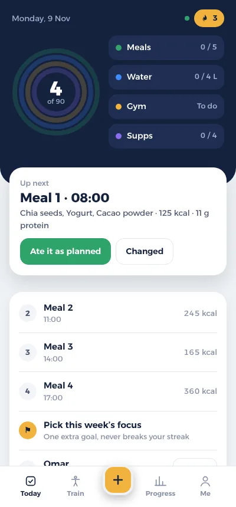
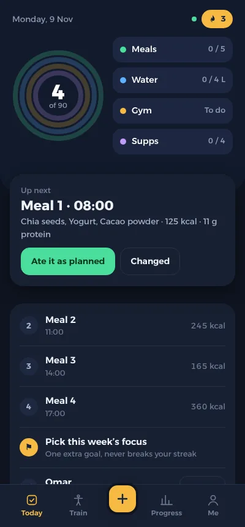
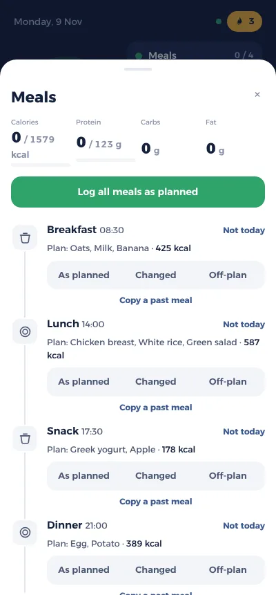
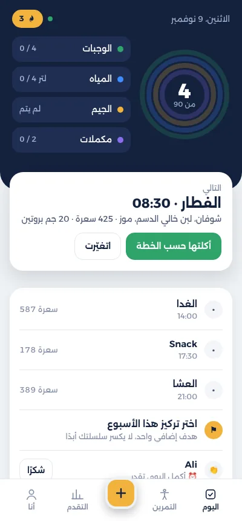

## Today

One screen for the day. A navy scoreboard shows four rings around the day number, one each for meals, water, training and supplements. Below it sit one "Up next" card with the single most useful thing to do now, and a short list of the rest. Tap any pillar for its details. Light and dark mode follow the phone, and the whole app also works in Arabic, right to left.

- **Two ways to use it:** a **daily tracker** (the default for new accounts) where you pick which goals make a full day, a bad day just shows lighter on the calendar, and nothing resets; or the **Lock In 90 challenge**. Switch any time in Me → Mode. In tracker mode without a meal plan, the food goal is logging what you eat, within an optional calorie target.
- **The challenge: every day needs all four:** every planned meal on plan, the water goal, that day's training and the core supplements. Miss one and the counter resets to Day 1. The day after a miss is flagged "Never miss twice."
- **Food:** your coach's meal plan or your own, one-tap "As planned", and calories and macros from a built-in library (Egyptian staples included, cooked weights). Drinks count toward water.
  - **Egyptian brands:** popular packaged products (Balance, Juhayna, Domty, Almarai, Lamar, Rich Bake, Abu Auf, Molto and more) checked against their labels, plus McDonald's Egypt from its published tables and Dunkin' cappuccino and latte (whole or skim milk, small to large). Anything else sold in Egypt can be searched on Open Food Facts, and entries whose calories don't add up are left out.
  - **Egyptian home and restaurant food:** about 50 dishes: mahshy (cabbage, vine leaves, mixed), mombar, fattah, macarona béchamel, bamya, mesa'a'a, rice with vermicelli, bessara, kebda, sogo', hamam mahshy and more; koshary by box size, foul and taameya sandwiches, liver and sogo' sandwiches, shawarma, fiteer and grills; sweets like konafa, qatayef and Om Ali; and drinks like sahlab, karkade and sugarcane juice. Search in Arabic, English or Franco ("wara2 3enab"), or by shop name ("Abou Tarek"). No Egyptian chain publishes nutrition, so dishes are worked out from typical recipes with USDA values for each ingredient and marked as estimates.
  - **Servings, not just grams:** pack, slice, cup, bar and so on, with a ½-step amount. The app remembers what you used last time.
  - **More nutrients:** sodium (and salt), sugar, saturated fat, fiber, potassium and calcium for each food and for the day, against WHO limits, with the foods that gave you the most sodium.
  - **Add from a label:** per 100 g or per serving, sodium or salt, your own servings, and a check that catches typos. You can photograph the nutrition table and the phone reads the numbers (on the phone itself, English and Arabic). Also barcode scan, USDA search and recipes.
  - **Drinks and cooking:** add milk, sugar, honey, creamer or sweetener to a coffee or tea, and the ghee, oil, butter or spray a food or meal was cooked with (with your own teaspoon size). Each is logged as one item. Cooking fat adds calories but never makes a meal off-plan.
  - **Weekly calorie budget (optional):** go over one day and the rest of your week's targets drop a little to pay it back, spread out or as soon as possible, never more than a set share of a day and never below a floor. Today's planned carb and fat portions shrink to match; protein never does.
  - **Daily list:** a "Daily" tab in Meals for the things you have most days (your coffee, your tea, a usual meal). One tap adds it, it shows when you had it and how many, and the first three sit as quick buttons on Today.
  - **Add a whole meal:** a burger, fries and a drink logged as one entry, as an extra or instead of a planned meal, allowed, off-plan or as your free cheat meal. Save it to your Daily list for one tap next time.
  - **Free cheat meal:** if your coach allows it, 1 or 2 a week (or 1 every 2 weeks), as one meal or a whole day. The day still counts, and the coach page marks it. A cheat meal never resets the challenge: if a recent day broke your streak only because of off-plan food, Today offers to count it as that week's free cheat meal and the streak comes back.
  - **Friends' foods:** share a food you added and everyone in your group can log it.
- **Your own week:** weeks start on the weekday you began (or Saturday, or any day you pick) for the weekly review, focus, muscle sets and cheat meal. The friends league stays Saturday to Friday.
- **Your day, your clock:** the new day starts at midnight by default, or at Fajr (worked out daily for 20 Egyptian cities) or a set time, so logging at 1 am still counts for the day you're in.
- **Habits:** a morning commitment, if-then plans for risky moments, a 3-tap reflection after a missed day, a 10-minute craving tool, a sleep goal with a bedtime reminder, and one weekly focus goal.
- **Ramadan mode:** a Suhoor / Iftar / after-Taraweeh plan, water paced from iftar to fajr, and an iftar countdown.

## Train

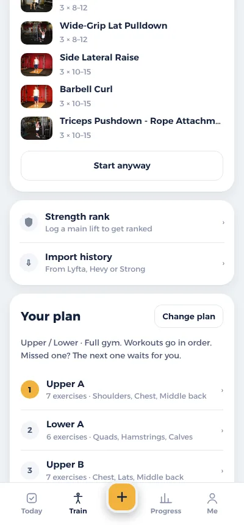
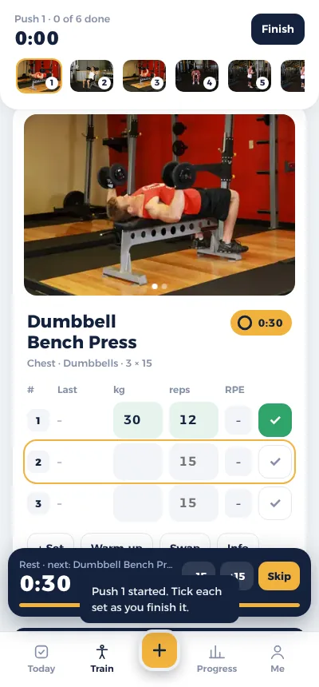
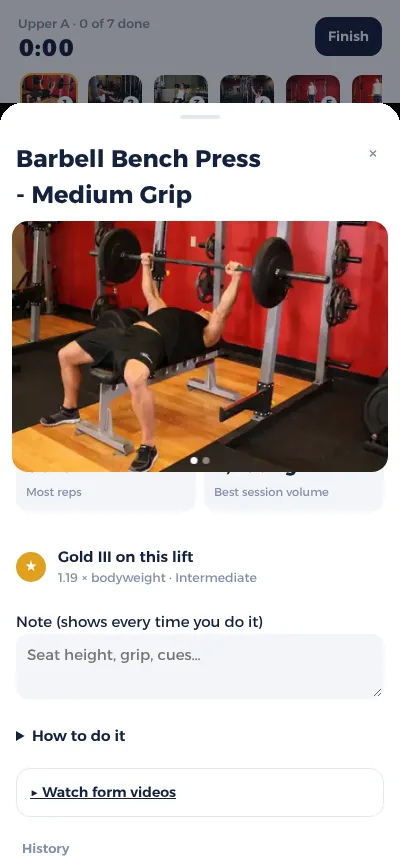
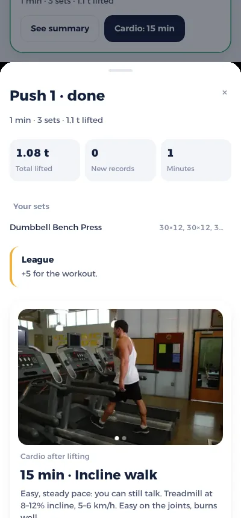

- **A plan for anyone:** a short setup asks where you train (full gym, dumbbells, or no equipment), your goal, experience and days per week. It then builds a plan: full body, push/pull/legs, upper/lower, PPL + upper/lower, body-part split, or PPL ×2. You can edit any workout or build your own.
- **Guided logging:**
  - Start and end photos for each exercise, with last time's numbers pre-filled and a tip on when to add weight.
  - Warm-up (W), drop (D) and to-failure (F) sets, an optional effort score (RPE), supersets, and a pinned note per exercise.
  - A warm-up and plate calculator.
- **Rest timer:** sits next to the exercise name (0:30 by default, changeable per exercise or for all), with a small bar for −15 / +15 / Skip. On Android, the lock-screen notification has **Set done** and **Skip rest** buttons.
- **After the workout:** a summary compared with last time, records, and optional cardio after lifting.
- **Library:** 873 exercises covering machines, cables, barbell, dumbbells, kettlebells, bands, bodyweight and stretches. Search and filter by muscle or equipment. Each exercise page has a progress chart and records.
- **Import:** bring workout history over from Lyfta, Hevy or Strong (CSV export).
- **Sports and cardio:** log football, padel, tennis and more. Calories come from the 2024 Compendium of Physical Activities, or your average heart rate. A 12-week stamina plan is included.

## Calisthenics

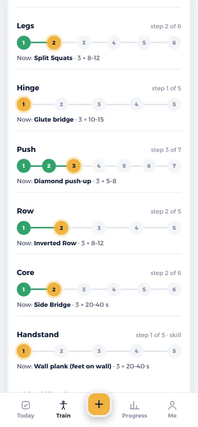
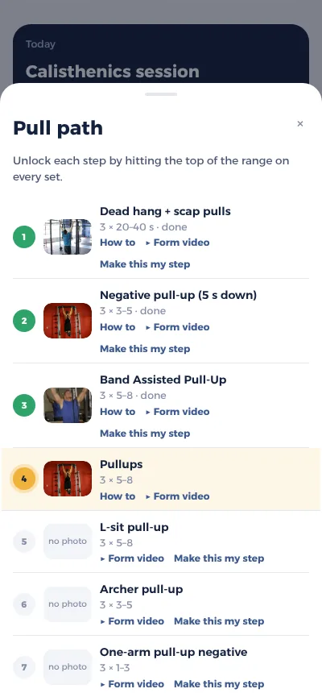

- **Skill paths:** push, pull, dip, row, legs, hinge and core, each a ladder of steps from easy to hard (incline push-up to one-arm push-up, dead hang to one-arm pull-up negative, and so on). Add skill paths for handstand, L-sit, front lever, planche and muscle-up.
- **Placement test:** five minutes of max reps and holds places you on every path.
- **Sessions:** built from your current step on each path, in the order of the Reddit Bodyweight Fitness "Recommended Routine": skills first, then three strength pairs (pull + dip, legs + hinge, push + row), then core.
- **Level up:** hit the top of the range on every set and the next step unlocks; you choose to move up or stay. Steps with a photo in the library show it; the rest link to form videos.

## Progress, ranks and friends

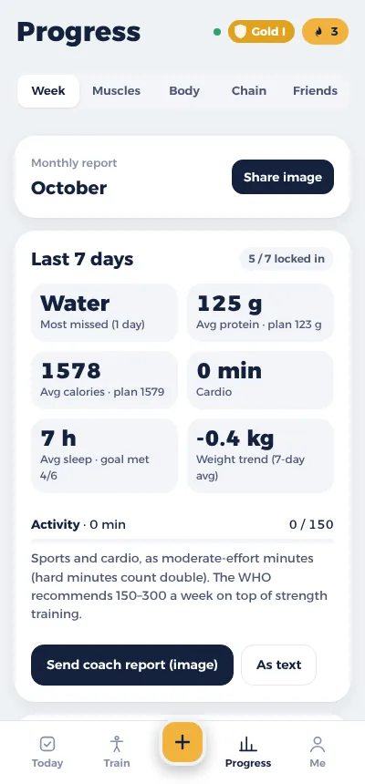
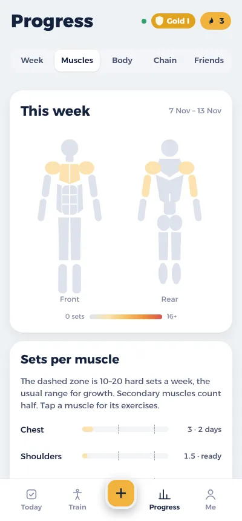
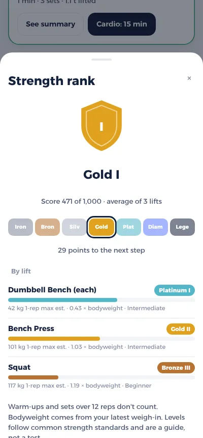
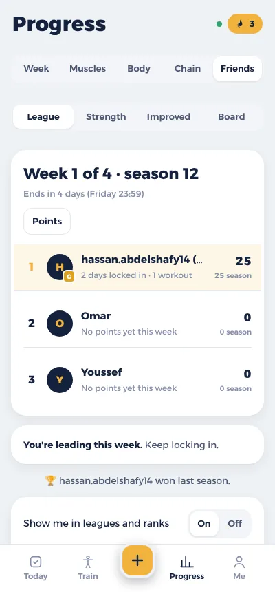

- **Week, Muscles, Body and Chain tabs:**
  - Week: the weekly review and a shareable coach report.
  - Muscles: a body map of sets per muscle against the 10–20 sets range, with recovery days.
  - Body: weight trend and measurements.
  - Chain (challenge) or Calendar (tracker): the 90-day chain, or a month shaded by goals hit, and the history of each day.
- **Monthly report:** a shareable image on the 1st of each month.
- **Strength rank:** seven ranks (Iron, Bronze, Silver, Gold, Platinum, Diamond, Legend), each with three steps, from your best estimated 1-rep max relative to bodyweight on main lifts, or reps for pull-ups, dips and push-ups. Your rank badge sits on Today, Train and Me. The ranks page lists every rank with what it takes at your bodyweight, and your friends' ranks. Warm-ups and sets over 12 reps don't count.
- **Friends:** create a group and share the 6-letter code.
  - **Weekly league:** points come from discipline, not raw strength, so a beginner can win. A locked-in day is +10, a workout +5, a record +3.
  - **Other boards:** a strength board that compares fairly across bodyweights (DOTS), a most-improved board, and the board with cheers and nudges.
  - **Privacy:** only these numbers are shared, never what you ate, your weight or photos (foods you add can be shared with the group if you choose). Anyone can hide themselves.
- **Coach link:** a private read-only page for your coach that updates by itself.
- **Start over your way:** a new attempt that keeps history, or clear exactly what you choose. Your group always stays, and friends can be told.

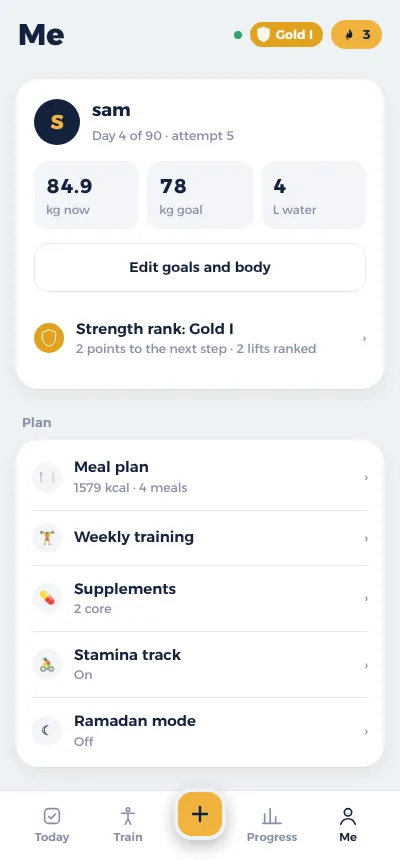

_Screenshots use a demo account with made-up data._

## How it runs for free

- **Hosting:** GitHub Pages serves the app. A service worker caches it for offline use and updates it in the background.
- **Data:** Firebase Auth and Firestore on the free Spark plan. Each collection loads from the phone's cache and only fetches what changed, so about 60 people fit.
- **Reminders:** a scheduled job runs every 30 minutes and sends smart reminders as app notifications through Firebase Cloud Messaging (free), or through ntfy for anyone who hasn't turned those on.

## Privacy and security

- The repo is public, so nothing private lives in it: no keys, no personal plans, no emails. The Firebase web config and the push public key are designed to be public; access is controlled by `firestore.rules` (each person can only read and write their own data).
- Keys for the reminder job live only in encrypted GitHub Actions secrets, never in the code.
- The friends board shares only day count, streak, today's status, league points and rank; never what you ate, your weight or photos. A food you add is shared with your group only if you tick "Share with my group".

## Credits

- Exercises and photos: [free-exercise-db](https://github.com/yuhonas/free-exercise-db), public domain (`ex/LICENSE-free-exercise-db.md`).
- Food data: [Open Food Facts](https://world.openfoodfacts.org) (ODbL), [USDA FoodData Central](https://fdc.nal.usda.gov) (public domain), McDonald's Egypt published nutrition tables, Dunkin' nutrition guide (calories; the rest worked out from the milk). Label reading: [Tesseract.js](https://github.com/naptha/tesseract.js) (Apache 2.0), loaded only when you use it.
- Font: [Alexandria](https://fonts.google.com/specimen/Alexandria), SIL Open Font License (`fonts/OFL-Alexandria.txt`).
- Sports calories: 2024 Adult Compendium of Physical Activities. Body numbers: NICE 2022 waist-to-height bands and the US Navy body-fat formula.
